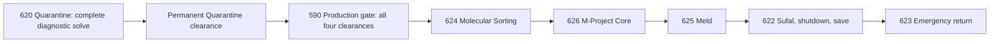

# Soylent System completion analysis

Analysis date: September 24, 2026. Scope: current standalone Soylent sources,
authored content, release evidence, and automated checks. No gameplay code,
selected release, disc image, memory card, or live save was changed. No emulator
playthrough was performed.

The dungeon has a substantial eighteen-field foundation and a distinctive
clinic opening, but a fresh campaign cannot reach its finale. The most useful
next step is to complete and validate the existing footprint, then deepen its
production puzzles and dramatic scenes. More rooms are not the main need.

## What exists and what actually works

| Area | Source-level status | Completion implication |
|---|---|---|
| Entry, Intake, registration, physician appointment | Implemented, including alias selection and timed appointment | Preserve the playable clinic sequence; test its timing and recovery from a fresh start. |
| Office security confrontation and Security keycard | Implemented with staged actors and recovery substates | Balance against the actual starting party and test victory, defeat, and reload. |
| Examination rooms and patient records | Implemented; field 593 owns the Quarantine keycard | Keep most records optional; make mandatory registration and card collection legible. |
| Quarantine diagnostics | Relay puzzle exists, but the continuation action is replaced by a development endpoint | Restore the solve, permanent clearance, and animated transition together. |
| Service, scanner, resonance, stabilization ward | Source-level access exists via Intake after Security | These are available before the blocked production wing; the scanner is required despite its optional label. |
| Sorting, M-Project Core, Meld, Sufal | Implemented foundations, blocked by unobtainable Quarantine clearance on a fresh run | Activate and inspect them; they are not blank rooms requiring creation from scratch. |
| Save, shutdown, emergency return | Implemented in Generation Hall, behind the blocked progression | Verify actual save persistence, boss recovery, and completed return behavior. |
| Selected standalone release | Receipt path fails validation after workspace relocation | Establish a new reproducible local candidate before emulator acceptance. |

Static room-level analysis with credentials obtainable before the cutoff gives
**14 reachable fields and four blocked fields**. This describes source logic,
not fourteen rooms verified in the emulator. The blocked sequence is:

The current door override removes the first arrow. Service remains reachable
through Intake, but that alternate route cannot supply the missing clearance.

## Findings that determine the completion work

1. **The cutoff suppresses progression, not just a doorway.**
   `build.py:10472` installs `_prepare_quarantine_current_end`; its field-620
   entity-24 action is repeatable dialogue with no state write or transition.
   The original action in `base.py:2185` commits `quarantine_complete`.
   Ward 590 still requires that flag in `build.py:7396`. Restoring only a
   field change, or assigning the flag at New Game, would bypass the puzzle.
   The release must restore the actual successful diagnostic action and its
   failure/repeat behavior.

2. **Two back-half puzzles are currently the same checklist.**
   Sorting and Core both call `_install_switch_puzzle` (`build.py:7657`). Each
   console unconditionally sets one local bit (`build.py:4635`), and the exit
   accepts all three bits. There are no routing choices, safe-state choices,
   or ordering decisions. These actions establish functional scaffolding but
   need distinct mechanics to sustain the second half.

3. **The best thematic puzzle already exists.**
   Quarantine requires Genome, Limiter, and Nanomachines enabled, with Caste
   Index excluded (`base.py:1812`). That makes the player's action reject
   Solaris's classification of human worth. Preserve this. Blueprint references
   to “all four biological diagnostics” are inaccurate: there are four
   controls, but only three biological markers belong in the solution.

4. **Required and optional content are mislabeled.**
   Archive registration is required even though the room is described as an
   optional records annex. Reading records again can remain optional.
   Scanner 588 is also called optional, but its `interface_cutoff_armed` flag
   is required by `production_clearance` (`blueprint.py:563`). Recommend
   keeping the four-clearance design and labeling the scanner as required.

5. **Pacing and recovery are underdeveloped.**
   The encounter contract disables random encounters and specifies clinic
   security plus Sufal (`content/dungeon_plan.json:875`). The explicit authored
   save console is in field 622 (`build.py:7927`). Establish a convenient
   checkpoint and recovery opportunity before production. Measure the middle
   section before adding encounters; one or two curated confrontations may
   help, while routine battles in every clinic room would weaken the setup.

6. **Partial puzzle work does not persist across room exits.**
   Sorting/Core use field-local `0x07D0`; completion becomes persistent only
   when the solved onward exit is used (`build.py:7610`). Decide whether partial
   settings should survive leaving. Either implement persistence with reviewed
   state allocation or clearly communicate reset behavior. A solved room must
   remain solved after native save/load and return visits.

7. **The finale is a useful foundation, not accepted gameplay.**
   `_boss_action` already uses native Sufal configuration 9, a pending-epilogue
   bit, and a permanent secured flag (`build.py:7814`). Generation installs
   the native save-menu handoff and gates the reciprocal 622–623 return on
   completion. Retain this recovery model. Expand scene staging and establish
   a clear player-facing ending beyond unlocking an internal shortcut.

8. **Documentation and release identity have drifted.**
   `project.json` declares V236, the blueprint release constant is 232, and
   `dungeon_plan.json` and the retained guide describe V233. The guide's opening
   calls the dungeon complete, while the module README correctly documents
   the unfinished boundary. Create one current status reference and explicitly
   label retained release narratives as historical.

## Recommended dungeon arc

Keep the existing eighteen fields. Let the clinic initially appear credible,
then allow the player's discoveries and interventions to expose the facility.
Do not have hopeful patients explain the entire horror before the reveal.

| Field(s) | Purpose in the finished dungeon | Proposed completion work |
|---|---|---|
| 623 Vestibule | Arrival and completed return | Give a clear initial objective and a short shutdown acknowledgement on return. |
| 621 Intake | Orientation and recurring human stakes | Update directions after registration/security/clearance; provide accessible checkpoint/recovery after the confrontation. |
| 549 Archive | Mandatory cover registration, optional records | Preserve the animated terminal. Provide concise classification clues without revealing Meld early. |
| 550 Office | The first rupture in the facility's reassuring appearance | Preserve the staged refusal, security entrance, keycard, and doctor exit; verify battle balance and resource recovery. |
| 567 Empty examination room | Brief atmospheric contrast | Keep its empty bed and no-patient record; it does not need another objective or fight. |
| 591–594 Occupied clinical rooms | Individual people behind the medical records | Preserve distinct patients; use 591/592/594 as optional clues. Keep 593's deliberate card choice and sole-writer contract. |
| 620 Quarantine | Establish that transformed patients remain human | Restore the three-on/one-off solve, persistent clearance, and east exit while retaining the west return. |
| 565 Service | Navigation between specialist authorizations | Show which production approvals remain. Give the permanently sealed e7 door a convincing final description unless a new purpose warrants expansion. |
| 589 Resonance | A different kind of interaction | Retain replayable five-tone clue and native directional entry; provide readable direction support and safe wrong-answer retry. |
| 588 Scanner | Required safety authorization | Explain why living-subject cutoff is needed. Give explicit confirmation and repeat status; award no keycard. |
| 590 Stabilization | Transition from treatment to production | Add a short scene or environmental evidence that clarifies the stakes. List missing production clearances specifically. |
| 624 Sorting | Intervene in the processing system | Offer reversible feed routing: tissue to stasis, medium to reclamation, unstable Meld to containment. Show current assignments and validate on confirmation. |
| 626 M-Project Core | Choose a safe shutdown | Distinguish fusion OFF, pattern OFF, containment ON. Make retaining containment a meaningful decision with clear status feedback. |
| 625 Meld | Emotional climax before combat | Stage the revelation through camera/actor beats and party reactions. Allow space for the scene; avoid another console scavenger hunt here. |
| 622 Generation | Sufal, local shutdown, completion | Signal boss commitment; retain save and retry recovery. Confirm permanent completion and a usable return route. |

The first rewards can be useful clues, recovery, changed room states, and
shortcuts. If consumable caches or additional fights are introduced, define
their resource and one-time state ownership before implementation. The current
bootstrap grants all native on-foot deathblows while preserving other stats
(`tools/surface_soylent_campaign_title.py:8`); balance must use that actual
starting party rather than assumed retail progression.

## Implementation order and acceptance gates

| Priority | Work package | Required result |
|---|---|---|
| P0 | Repair the verification baseline | Tests resolve configured donors; current status distinguishes historical narrative from V236 sources; a uniquely named local build passes launcher checks. |
| P1 | Finish the complete route | Quarantine success awards clearance once; native east door works in both directions; no production bypass; fresh start reaches Sufal and the completed return loop. |
| P2 | Give production rooms distinct mechanics | Sorting and Core require different, understandable decisions; wrong choices are recoverable; feedback and revisit behavior are consistent. |
| P3 | Finish pacing and scenes | Midpoint checkpoint/recovery, legible objectives, staged Meld/finale, measured combat difficulty, and useful optional exploration. |
| P4 | Accept one release in the emulator | Complete the matrix below against an exact media hash, then mark gameplay passed only with recorded evidence. |

Do P1 before expanding the footprint or designing additional quests. The first
milestone is an entire playable dungeon with the existing puzzle foundations;
the later pass makes it a satisfying finished dungeon.

## Verification performed during this analysis

- `project.py status` and `project.py tools`: current Soylent selection is
  `rico-ch2-scene-v4-recovered`; receipt validation rejects its old output path.
  The configured Python, shared tools, Xenoiso, and DuckStation are present.
- `project.py doctor`: all five configured source identities pass, including
  the pinned normalized V166 donor. The problem is not absence of configured
  project sources.
- `project.py play soylent_system --check-only`: fails with “Build receipt
  output directory disagrees with selected release.” The receipt still names
  the old `C:\Users\Chad\Xenogears_Reimagined` workspace. No emulator was opened.
- Independent read-only comparison of the selected BIN, CUE, and stage manifest
  against its receipt found matching sizes and hashes. The BIN SHA-256 is
  `e228a01d3dac8f491ef96ef5b175b73fb1a2b413e18e03549f2dbd232e562268`, matching the
  historical V236 identity. This establishes media identity, not current-source
  freshness or gameplay acceptance. Rebuild a local candidate instead of editing
  an old receipt to bypass validation.
- `project.py test soylent_system`: **662 tests run, one setup error, 55 skips**
  in 85.943 seconds. The error is `SurfaceSoylentCompleteDungeonTests` using
  hardcoded V163 and the old user's Disc 1 path. Main campaign tests also skip
  when those historical paths are missing. The profile suite is not green.
- A separate audit run imported the existing campaign test module, assigned
  its `SOURCE_DISC` to configured `mass_driver_base` and `DONOR_DISC` to
  configured `pw_disc1`, and ran its existing suite without changing source or
  test files: **62 tests passed, no skips**, in 27.094 seconds. This exercises
  preparation, frozen identities, geometry, gates, dialogue, and scripted-state
  expectations against the configured donors. It does not repair the profile
  test command or establish native runtime behavior.

Logs: [profile test run](../work/soylent-analysis-tests-2026-09-24.log) and
[configured-donor campaign test run](../work/soylent-analysis-configured-campaign-tests-2026-09-24.log).

## Required gameplay acceptance matrix

| Scenario | Evidence needed |
|---|---|
| Fresh New Game | Correct Fei/Elly/Citan party and reset state; playable entry without importing an old savestate. |
| Registration/appointment | Each alias, clock threshold, leaving/reentering while waiting, dialogue overlap, and native save/reload. |
| Clinic confrontation | Every refusal stage, visible security arrival, victory/defeat/retry, keycard awarded once, doctor departure, and restored player control. |
| Credentials | Missing-card denials; field-593 Leave/Accept/repeat; no second Quarantine-card source. |
| Quarantine | Wrong relays, caste exclusion, correct solve, permanent award, both doors, and return after completion. |
| Specialist approvals | Tone clue versus actual authorization; wrong-code retry; scanner cutoff; each missing production prerequisite independently denied. |
| Sorting/Core | All meaningful configurations, feedback, leave/reenter, native save/load, solved revisits, and no premature gate opening. |
| Meld/Sufal | First/repeat reveal, preboss save, defeat/retry, battle return, epilogue interruption/recovery, no repeat boss after victory. |
| Completion | Secured state survives cold reload; both emergency-return directions work; ending explains that this node is shut down while others remain. |
| Physical traversal | Fresh X versus held X/Forward, off-center approaches, seals, animations, arrival positions, and no immediate bounce. |
| Stability | Ten full round trips and a thirty-minute soak, as already requested by the campaign plan. |

Static tests must also prove that every prerequisite has a reachable writer
starting from reset state. The existing blueprint graph is explicitly a future
foundation; testing that graph alone cannot certify the live route. The current
campaign test deliberately asserts the development cutoff. Replace that
expectation when the continuation is completed.

## Constraints for implementation

Use the canonical `modules/soylent_system` implementation and shared tools.
Retain the pinned normalized V166 donor until its preparation is independently
replaced and verified. Preserve the exact door, graphics, walkmesh, and actor
contracts unless an intentional change includes corresponding verification.

Review [the resource ledger](../shared/resources.json) before allocating state:
`0x03FA` is already assigned, its low four bits belong to Mass Driver, and the
appointment phase is packed rather than independent flags. `0x03EE` is shared
by context with Rico; reused retail words are not exclusively Soylent-owned.
Do not take an apparently unused bit for new puzzle persistence or rewards.

Preserve the authored identity of this location as the Disc 2 Ignas surface
installation, the human identity of its victims, Meld and Sufal, and the local
rather than worldwide shutdown outcome. Standalone acceptance and combined
selector acceptance remain separate; the combined New Game black-screen report
is not resolved by this analysis. Protect Mass Driver's Miang sequence and all
unrelated existing workspace changes.

Principal sources: [module guide](../modules/soylent_system/README.md),
[campaign builder](../modules/soylent_system/build.py),
[field foundation](../modules/soylent_system/base.py),
[blueprint](../modules/soylent_system/tools/surface_soylent_campaign_blueprint.py),
[campaign tests](../modules/soylent_system/tests/test_build_surface_soylent_campaign.py),
and [development workflow](development-workflow.md). Code line references above
refer to the September 24 source snapshot.
